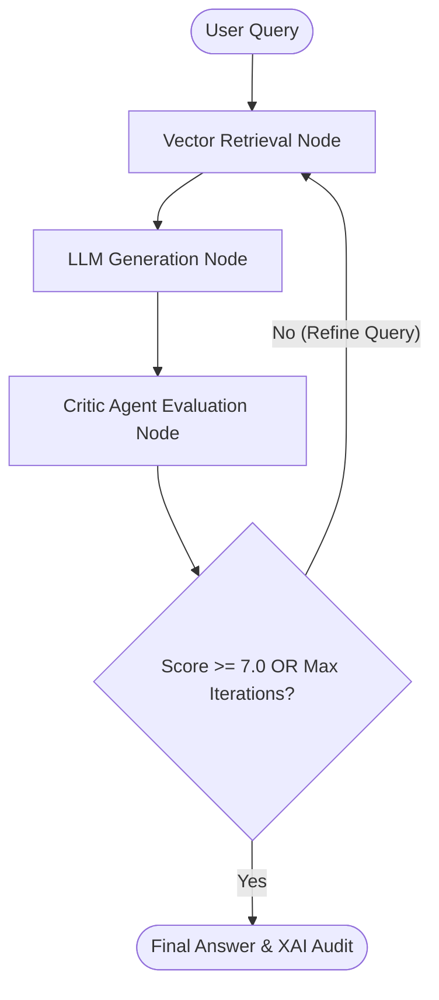

# 🦀 GFRIG Advanced Micro-RAG Pipeline in Rust

A high-performance, asynchronous implementation of an **Advanced Micro-RAG System with Reranking, Critic Evaluation, Feedback Loops, and Persistence**, ported from Python's LangGraph framework into the Rust ecosystem.

This crate combines **`graph-flow`** for graph-based workflow concepts, **`rig`** for LLM orchestration, **`sqlx`** for async SQLite vector storage, and **`Ollama`** for local model inference (`glm4:9b` / `mistral:7b` and `nomic-embed-text`).

---

## 🏗️ Architectural Principles & Workflow

Unlike basic linear RAG pipelines ($\text{Query} \to \text{Retrieve} \to \text{Generate}$), this advanced implementation introduces **self-refinement loops, critic validation, and dynamic state tracking**.



### Core Design Principles:

1. **State-Driven Execution (`AdvancedRagState`)**:
   - The workflow maintains an explicit state object containing the active query, retrieved document chunks, generated answer, critic score, iteration accumulator, and an append-only XAI audit trail.

2. **Async SQLite Vector Engine (`sqlx`)**:
   - Uses `sqlx` (`sqlite`) to store raw document content and vector embeddings represented as JSON-encoded floating-point arrays.
   - Vector similarity is evaluated dynamically using Cosine Similarity over normalized embeddings.

3. **Critic Agent & Cyclic Feedback Loop**:
   - After answer generation, a **Critic Node** evaluates the response quality against quality thresholds.
   - If the score falls below `7.0/10.0` and the maximum iteration limit (`max_iterations = 3`) is not reached, the system refines the prompt query and loops back to retrieval.

4. **XAI & Auditability**:
   - Every state transformation logs its input, generated output, and metadata into `audit_trail`, allowing full inspectability in formatted JSON.

---

## 📁 Crate Structure

* **`src/lib.rs`**: Core library containing:
  - `AdvancedRagState` and `RagStepRecord` data structures.
  - `AdvancedRagDatabase`: `sqlx`-backed asynchronous SQLite pool manager.
  - Vector similarity search (`cosine_similarity`).
  - Embedding retrieval function via Ollama HTTP API (`get_embedding`).
* **`src/main.rs`**: Executable binary orchestrating the multi-step evaluation loop, Rig agent instantiation, context building, and JSON output generation.
* **`tests/advanced_rag_tests.rs`**: Integration test suite validating cosine calculation and database operations inside isolated temporary files (`tempfile`).

---

## ⚙️ Prerequisites

1. **Rust Toolchain**: Stable Rust `1.75+` (2024 edition supported).
2. **Ollama Instance**: Ensure Ollama is running locally on `http://localhost:11434` with the required models loaded:
   ```bash
   ollama pull nomic-embed-text
   ollama pull glm4:9b
   ```

---

## 🚀 Building & Execution

### 1. Run Unit & Integration Tests
Execute the asynchronous test suite (runs on an in-memory/temporary SQLite database):
```bash
cargo test
```

### 2. Run the Main RAG Pipeline
Run the binary to index sample data, run the iterative loop, and display the final answer and audit trail:
```bash
cargo run
```

---

## 🔍 Example Console & XAI Audit Output

Upon running `cargo run`, the agent produces structured logging followed by a JSON audit trail:

```text
=== RUST ADVANCED MICRO-RAG PIPELINE (Rerank, Critic & Loop) ===

✅ Sample document indexed into SQLite vector store.

🔄 --- Iteration 1 ---
⏳ Running retrieval for query: 'What is Autogen?'...
⏳ Generating answer...
⏳ Critic agent evaluating answer...
📊 Critic Score: 8.5/10.0
✅ Target score achieved. Exiting loop.

========================================
--- 🎯 Final Answer ---
Autogen is a generalized multi-agent conversation framework designed to simplify the development of high-performance multi-agent applications, particularly demonstrating strength in Math Problem Solving (A1).
```

### JSON Audit Trail Structure:

```json
{
  "question": "What is Autogen?",
  "documents": [
    "AutoGen is a generalized multi-agent conversation framework..."
  ],
  "context": "[Score: 0.79] AutoGen is a generalized multi-agent conversation framework...",
  "answer": "Autogen is a generalized multi-agent conversation framework...",
  "critic_score": 8.5,
  "iteration": 1,
  "audit_trail": [
    {
      "step_name": "retrieval_iter_1",
      "input_data": "What is Autogen?",
      "output_data": "Retrieved 1 chunks"
    },
    {
      "step_name": "generation_iter_1",
      "input_data": "Context:\n...",
      "output_data": "Autogen is a generalized multi-agent..."
    },
    {
      "step_name": "critic_iter_1",
      "input_data": "Autogen is a generalized multi-agent...",
      "output_data": "Score: 8.5"
    }
  ]
}
```