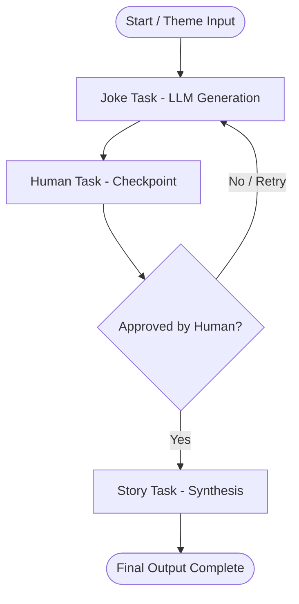

# 🦀 GFRIG Human-in-the-Loop (HITL) Agent in Rust

A robust, asynchronous implementation of a **Human-in-the-Loop (HITL)** iterative cycle agent ported from Python's **LangGraph** framework into the Rust ecosystem.

This crate leverages **`graph-flow`** for graph orchestration and conditional state branching, **`rig`** for LLM prompt management and agent construction, and **`Ollama`** for local LLM inference (`glm4:9b` or `mistral:7b`).

---

## 🏗️ Architectural Principles & Workflow

In traditional linear workflows ($A \to B \to C$), human verification or feedback loop cycles require complex external state management. This implementation utilizes a **reactive feedback loop** where execution halts at a Human Checkpoint Node, allowing human input (`yes` / `no`) to route execution forward or loop back to refine LLM generation.



### Core Design Principles:

1. **State Persistence (`GraphContext`)**:
   - The workflow maintains state across task boundaries, storing `theme`, `joke_text`, `story_text`, `approved`, and an `iteration` counter.

2. **Interactive Checkpoint (`HumanTask`)**:
   - Pauses execution and requests interactive feedback from the terminal user (`stdin`).
   - Dynamically modifies the `approved` state flag based on human selection.

3. **Self-Correction & Retry Cycle**:
   - Rejection by the human operator routes the pipeline back to the `JokeTask` node, incrementing the iteration count and producing a fresh generation.
   - Approval routes execution forward to the `StoryTask` node, synthesizing a full story leading to the joke's punchline.

---

## 📁 Crate Structure

- **`src/lib.rs`**: Core library defining graph tasks and data structures:
  - `HitlState`: Shared state model for serialization/deserialization.
  - `JokeTask`: LLM-powered joke generator task using `rig`.
  - `HumanTask`: Terminal user input checkpoint task.
  - `StoryTask`: Contextual story synthesizer task.
- **`src/main.rs`**: Interactive binary executable orchestrating the runtime cycle.
- **`tests/human_loop_tests.rs`**: Automated test suite utilizing mock task implementations to test approval and retry loops without requiring manual terminal input or an active LLM host.

---

## ⚙️ Prerequisites

1. **Rust Toolchain**: Stable Rust `1.75+` (2024 edition supported).
2. **Ollama Instance**: Ensure Ollama is running locally on `http://localhost:11434` with the target model pulled:
   ```bash
   ollama pull glm4:9b
   # or
   ollama pull mistral:7b
   ```

---

## 🚀 Building & Running

### 1. Run Unit & Integration Tests

Execute the automated test suite (uses mocked task nodes for fast, deterministic testing):

```bash
cargo test
```

### 2. Run the Interactive Binary

Launch the executable to test the interactive Human-in-the-Loop terminal workflow:

```bash
cargo run
```

---

## 🔍 Example Terminal Session

```text
=== RUST HUMAN-IN-THE-LOOP (HITL) PIPELINE ===

🤖 Generating a joke...

🤖 -> [JokeNode] Generating a joke on the topic: 'universe' (Attempt no. 1)
--------------------------------
Why don't aliens visit Earth? 
Because they looked at the reviews and saw only 1 star!
--------------------------------

👤 --- HUMAN INTERACTION (HITL) ---
Do you like this joke, or do you want to generate a new one?
--------------------------------
Why don't aliens visit Earth? 
Because they looked at the reviews and saw only 1 star!
--------------------------------
Enter 'yes' to continue to the story, or anything else to rewrite the joke: no
🔄 The user rejected the joke. Returning to JokeNode (Cycle).
🔄 User did not approve the joke, repeating the cycle...

🤖 Generating a joke...

🤖 -> [JokeNode] Generating a joke on the topic: 'universe' (Attempt no. 2)
--------------------------------
How do astronauts organize a party in space?
They planet!
--------------------------------

👤 --- HUMAN INTERACTION (HITL) ---
Do you like this joke, or do you want to generate a new one?
--------------------------------
How do astronauts organize a party in space?
They planet!
--------------------------------
Enter 'yes' to continue to the story, or anything else to rewrite the joke: yes
✅ User approved the joke! Heading to StoryNode.

📖 Generating a story...

📖 -> [StoryNode] Generating a story leading up to the joke's punchline...

--------- FINAL RESULT ---------
Joke:
How do astronauts organize a party in space?
They planet!

Story:
On the International Space Station, Commander Sarah realized her crew was feeling homesick.
Deciding they needed a morale boost, she secretly coordinated with mission control to set up 
a celebration floating zero-g style. When asked how she managed the orbit logistics so smoothly, 
she smiled and explained: "How do astronauts organize a party in space? They planet!"

✅ Workflow successfully completed!
```