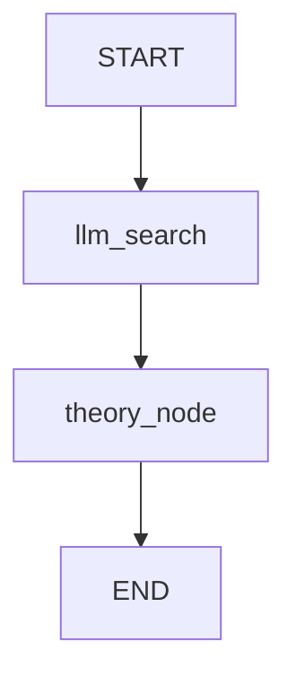

# 🦀 GFRIG Hybrid Agent: RAG & Theory Synthesis in Rust

A high-performance, type-safe implementation of a **Hybrid RAG & Sequential Synthesis Agent** ported from Python's LangGraph framework into the Rust ecosystem. This project leverages **`graph-flow`** for graph orchestration, **`rig`** for LLM integration, and **`Ollama`** for local model inference (e.g., `glm4:9b`).

---

## 🏗️ Architectural Overview & Principles

Unlike standard Directed Acyclic Graph (DAG) engines that cannot handle state cycles or complex session handoffs, this project uses a structured state-machine approach with persistent session storage.



### Core Design Principles

1. **Hybrid Pipeline Structure**:
   - **Phase 1 (Context Retrieval):** The `llm_search` node acts as an intelligent research agent, querying the base topic and generating a comprehensive contextual baseline.
   - **Phase 2 (Sequential Synthesis):** The `theory_node` reads the populated context from the shared session storage, applying domain-specific system prompts (physics expert persona) to synthesize structured theoretical insights.
2. **State Management & Persistence**: Data flows through a shared session `Context`. Because `graph-flow` transmits execution contexts by value, explicit save/restore cycles via `SessionStorage` are implemented to preserve states across asynchronous node boundaries.
3. **XAI Audit Trail**: Every node execution logs its inputs and outputs into an immutable audit trail (`audit_trail`), serializable to a clean JSON report for explainable AI (XAI) verification.

---

## 📁 Project Structure

- **`src/lib.rs`**: Core library defining the workflow engine, `PhysicsWorkflowState`, `DynamicWorkflowBuilder`, and the asynchronous `UnifiedNode` implementation conforming to the `graph-flow` `Task` trait.
- **`src/main.rs`**: Executable entry point setting up the workflow nodes, session storage, sequential runner, and formatting the final console/JSON output.
- **`tests/hybrid_agent_tests.rs`**: Integration test suite verifying proper data propagation, context population, and structural assertions using mock execution tools.

---

## ⚙️ Prerequisites & Setup

1. **Rust Toolchain**: Ensure you have stable Rust installed (`rustc >= 1.75+`).
2. **Ollama**: Ensure Ollama is running locally (`http://localhost:11434`) with your desired model pulled:
   ```bash
   ollama pull glm4:9b
   ```
3. **Environment File**: Create a `.env` file in the root directory if custom configurations or API endpoints are required.

---

## 🚀 Building and Running

### 1. Run the Hybrid Workflow
Execute the main binary to run the pipeline over a physics topic (e.g., *Newton's laws of motion*):
```bash
cargo run
```

### 2. Run the Test Suite
Verify pipeline logic and state persistence with automated tests:
```bash
cargo test
```

---

## 📝 Code Highlights

### `UnifiedNode` Task Implementation (`src/lib.rs`)
The nodes dynamically adapt their prompt generation based on their execution ID and current session context:

```rust
#[async_trait]
impl Task for UnifiedNode {
    fn id(&self) -> &str {
        &self.id_str
    }

    async fn run(&self, context: Context) -> graph_flow::Result<TaskResult> {
        let topic = context.get::<String>("topic").unwrap_or_default();
        // ... execution logic with RIG and Ollama ...
        Ok(TaskResult::new(Some(output_data), next_action))
    }
}
```

---

## 🔍 Example XAI Audit Trail Output

When executed successfully, the agent produces a detailed JSON audit report:

```json
{
  "topic": "Newton's laws of motion",
  "context": "## Newton's Laws of Motion...",
  "theory": "The main physical theory and laws extracted...",
  "formula": "",
  "architecture_mermaid": "graph TD\n    START --> llm_search\n    ...",
  "audit_trail": [
    {
      "task_id": "llm_search",
      "input_data": "Newton's laws of motion",
      "output_data": "..."
    },
    {
      "task_id": "theory_node",
      "input_data": "Newton's laws of motion",
      "output_data": "..."
    }
  ]
}
```