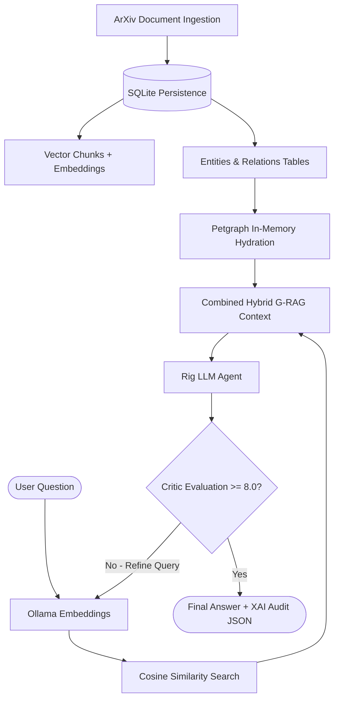

# 🕸️ Rust Micro Graph-RAG (G-RAG) Pipeline

A lightweight, high-performance **Graph Retrieval-Augmented Generation (G-RAG)** system implemented in **Rust**. It combines asynchronous **SQLite** persistence (`sqlx`) with fast in-memory knowledge graph traversal (`petgraph`) and an iterative self-correcting agent loop powered by [Rig](https://github.com/0xPlaygrounds/rig) and **Ollama**.

This tutorial demonstrates how to overcome the limitations of pure vector search by enriching LLM context with structured entity-relationship topologies—with zero external graph database server overhead (such as Neo4j).

---

## 🏛️ Architecture Overview

Traditional RAG retrieves isolated text chunks based solely on vector similarity. **G-RAG** extracts entities and directed relationships, persists them in SQLite, and hydrates an in-memory `petgraph::DiGraph` during retrieval to provide multi-hop structural context alongside vector similarity scores.



### Key Components
1. **Hybrid Storage (`src/lib.rs`):**
   * `documents` & `vector_chunks`: Stores raw text and JSON-serialized embeddings for cosine similarity ranking.
   * `entities`, `relations`, & `chunk_entities`: Relational adjacency schema representing directed knowledge graphs.
2. **In-Memory Graph Engine (`petgraph`):**
   * Dynamically hydrates SQLite rows into a `DiGraph<EntityNode, String>` and traverses outgoing edges (`1-hop` or `multi-hop`) to surface connected concepts.
3. **Self-Correcting Agent Loop (`src/main.rs`):**
   * Executes an iterative **Retrieve $\rightarrow$ Generate $\rightarrow$ Critique $\rightarrow$ Refine** cycle and outputs a complete **Explainable AI (XAI) JSON audit trail**.
4. **Integration Tests (`tests/graph_rag_tests.rs`):**
   * Verifies cosine similarity math, SQLite schema creation, graph ingestion, and hybrid retrieval using temporary databases (`tempfile`).

---

## 🛠️ Prerequisites

* **Rust** (Edition 2021/2024)
* **[Ollama](https://ollama.com/)** running locally (`http://localhost:11434`) with the following models pulled:
  ```bash
  ollama pull nomic-embed-text
  ollama pull glm4:9b
  ```

---

## 📦 Dependencies (`Cargo.toml`)

Ensure your `Cargo.toml` includes the core crates for async runtime, SQLite, graph traversal, and LLM orchestration:

```toml
[package]
name = "gfrig_micro_graph_rag"
version = "0.1.0"
edition = "2024"

[dependencies]
rig = "0.46.0"
graph-flow = "0.8"
sqlx = { version = "0.9.0", features = ["sqlite", "runtime-tokio", "tls-native-tls", "macros"] }
petgraph = "0.8"
tokio = { version = "1.38", features = ["full"] }
anyhow = "1.0"
dotenvy = "0.15"
async-trait = "0.1"
reqwest = { version = "0.13.5", features = ["json"] }
serde = { version = "1.0", features = ["derive"] }
serde_json = "1.0"
rand = "0.10.3"
uuid = { version = "1.0", features = ["v4", "serde"] }
futures = "0.3"
chrono = "0.4"  

[dev-dependencies]
tempfile = "3.10"
```

---

## 🚀 Step-by-Step Guide

### 1. Initialize & Ingest Knowledge (`src/lib.rs`)
The `AdvancedRagDatabase::init` method automatically provisions both vector and graph tables in SQLite. When ingesting a document (such as an ArXiv abstract on *Agentic Applications*), we store:
* The raw document and its vector chunk embedding.
* Extracted entities (`("Agentic Applications", "Concept", ...)`) and directed edges (`("Agentic Applications", "UTILIZES", "LangGraph")`).

### 2. Hybrid Retrieval (`search_graph_rag`)
During retrieval, two operations occur simultaneously:
1. **Vector Search:** Computes cosine similarity between the query embedding and stored chunks.
2. **Graph Traversal:** Loads entities and edges into `petgraph::DiGraph`, locates matching root nodes, and traverses neighbors to append structured relationship paths to the prompt.

### 3. Run the Pipeline
Execute the application to index the sample ArXiv paper, run the G-RAG query, and inspect the XAI audit log:

```bash
cargo run
```

### 4. Run Automated Tests
Verify the vector similarity functions and SQLite + Petgraph database operations without needing a live LLM server:

```bash
cargo test
```

---

## 📊 Sample Output

```text
=== RUST GRAPH-RAG AGENTIC PIPELINE (ArXiv Agentic Applications) ===

✅ ArXiv document & knowledge graph successfully indexed.

🔄 --- Iteration 1 ---
⏳ Running Graph RAG retrieval for query: 'How do agentic applications utilize frameworks like AutoGen and LangGraph?'...
⏳ Generating answer using Graph RAG context...
⏳ Critic agent evaluating answer...
📊 Critic Score: 9.0/10.0
✅ Target score achieved. Exiting loop.

========================================
--- 🎯 Final Graph RAG Answer ---
Agentic applications utilize frameworks like AutoGen and LangGraph by integrating them into their architecture to autonomously execute tasks...
```

---

## 🎯 Why SQLite + Petgraph for G-RAG?
* **Zero Infrastructure Overhead:** No external graph database daemons or Docker containers required—everything compiles into a single native binary backed by a single `.sqlite` file.
* **Sub-Millisecond Graph Algorithms:** Once hydrated into `petgraph`, you have immediate access to BFS, DFS, shortest-path, and centrality algorithms in memory.
* **Full Auditability:** Every retrieval step, context payload, and critic evaluation is recorded in `AdvancedRagState` for transparent XAI debugging.