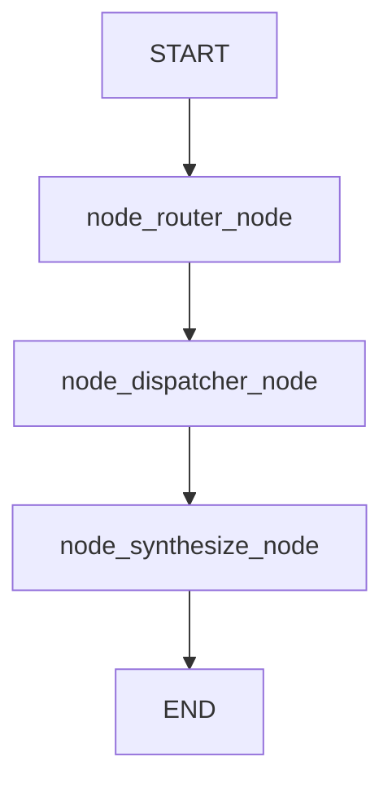

# 🚀 Rust Hybrid Workflow & Dynamic Router Engine (`gfrig_sequential_node`)

An advanced, modular, and type-safe agentic workflow engine written in **Rust**, leveraging **`graph-flow`** for graph execution/orchestration and **`rig`** for LLM integrations via **Ollama**.

This framework demonstrates the **Router-Worker Pattern**, effectively decoupling task execution logic from node definitions using injected asynchronous closures (`Arc<dyn Fn...>`). It enables local LLM agents to act as semantic routers, writing dynamic instructions into the shared session context, which are then deterministically executed by lightweight tools (e.g., calculators, MCP servers, or web scrapers).

---

## 🌟 Core Architectural Features

1. **Unified Node Abstraction (`UnifiedNode`)**:
   - **`CustomTool`**: Executes arbitrary, user-defined asynchronous closures injected directly from application code (`main.rs`).
   - **`LlmRouter`**: Evaluates state and query context to output semantic control decisions, automatically written to `context.set("router_decision", ...)` for downstream worker nodes. Includes built-in parsing defenses against verbose reasoning models.
   - **`LlmAgent`**: Performs multi-step state synthesis and generates final user responses based on accumulated tool outputs.

2. **Injected Business Logic**:
   - High performance and safety: deterministic operations (APIs, math, DB reads) run instantly as Rust futures without LLM latency or hallucination risks.

3. **XAI & Observability Built-In**:
   - **Dynamic Mermaid Topologies**: Generates structural diagrams (`graph TD`) of the workflow on the fly.
   - **JSON Audit Trails**: Records every execution step (`GraphStepRecord`), capturing inputs, step outputs, and final synthesis for structured logging or graph database ingestion (e.g., Neo4j).

---

## 🏗️ Workflow Visualization



---

## 📂 Code Overview

### 1. Library Core Engine (`src/lib.rs`)

The `lib.rs` file defines the `UnifiedNode` system, node execution modes (`NodeMode`), state context management, and the `DynamicWorkflowBuilder`.

```rust
use anyhow::Result;
use async_trait::async_trait;
use graph_flow::{
    Context, FlowRunner, GraphBuilder, GraphError, InMemorySessionStorage,
    NextAction, Session, SessionStorage, Task, TaskResult,
};
use rig::providers::ollama;
use serde::{Deserialize, Serialize};
use std::future::Future;
use std::pin::Pin;
use std::sync::Arc;

#[derive(Debug, Clone, Serialize, Deserialize)]
pub struct GraphStepRecord {
    pub task_id: String,
    pub input_data: String,
    pub output_data: String,
}

#[derive(Debug, Clone, Default, Serialize, Deserialize)]
pub struct WorkflowState {
    pub query: String,
    pub data: Vec<String>,
    pub final_answer: String,
    pub architecture_mermaid: String,
    pub audit_trail: Vec<GraphStepRecord>,
}

pub type ToolFn = Arc<
    dyn Fn(Context) -> Pin<Box<dyn Future<Output = Result<String>> + Send>>
        + Send
        + Sync,
>;

pub enum NodeMode {
    CustomTool {
        action_name: String,
        logic: ToolFn,
    },
    LlmAgent {
        model_name: String,
        preamble: String,
    },
    LlmRouter {
        model_name: String,
        preamble: String,
    },
}

pub struct UnifiedNode {
    pub id_str: String,
    pub label: String,
    pub mode: NodeMode,
}

#[async_trait]
impl Task for UnifiedNode {
    fn id(&self) -> &str {
        &self.id_str
    }

    async fn run(&self, context: Context) -> graph_flow::Result<TaskResult> {
        let query = context.get::<String>("query").unwrap_or_default();
        let mut data = context.get::<Vec<String>>("data").unwrap_or_default();

        let (output_data, next_action) = match &self.mode {
            NodeMode::CustomTool { action_name, logic } => {
                match logic(context.clone()).await {
                    Ok(res) => {
                        let result_str = format!("Tool [{}] executed -> {}", action_name, res);
                        data.push(result_str.clone());
                        context.set("data", data)?;
                        (result_str, NextAction::ContinueAndExecute)
                    }
                    Err(e) => {
                        let err_msg = format!("Tool [{}] failed -> {}", action_name, e);
                        data.push(err_msg.clone());
                        context.set("data", data)?;
                        (err_msg, NextAction::ContinueAndExecute)
                    }
                }
            }
            NodeMode::LlmRouter { model_name, preamble } => {
                let client = ollama::Ollama::new();
                let model = client.completion(model_name);

                let agent = rig::agent::AgentBuilder::new(model)
                    .preamble(preamble)
                    .build();

                let prompt = format!(
                    "Context Data: {:?}\nUser Query: {}\nChoose the next action/tool name precisely (output only the keyword like 'run_calculator' or 'run_scraping'):",
                    data, query
                );

                match agent.prompt(&prompt).await {
                    Ok(response) => {
                        let raw_output = response.output().trim().to_lowercase();
                        
                        // Reasoning model normalization defense
                        let decision = if raw_output.contains("calculator") || raw_output.contains("run_calculator") {
                            "run_calculator".to_string()
                        } else if raw_output.contains("scraping") || raw_output.contains("run_scraping") {
                            "run_scraping".to_string()
                        } else {
                            raw_output
                        };

                        context.set("router_decision", decision.clone())?;
                        
                        let result_str = format!("Router decided action: {}", decision);
                        data.push(result_str.clone());
                        context.set("data", data)?;

                        (result_str, NextAction::ContinueAndExecute)
                    }
                    Err(e) => {
                        let err_msg = format!("Router Error: {}", e);
                        (err_msg, NextAction::ContinueAndExecute)
                    }
                }
            }
            NodeMode::LlmAgent { model_name, preamble } => {
                let client = ollama::Ollama::new();
                let model = client.completion(model_name);

                let agent = rig::agent::AgentBuilder::new(model)
                    .preamble(preamble)
                    .build();

                let prompt = format!(
                    "Accumulated Context Data: {:?}\nUser Query: {}\nExecute final synthesis:",
                    data, query
                );

                match agent.prompt(&prompt).await {
                    Ok(response) => {
                        let output = response.output().trim().to_string();
                        context.set("final_answer", output.clone())?;
                        (output, NextAction::End)
                    }
                    Err(e) => {
                        let err_msg = format!("LLM Execution Error: {}", e);
                        (err_msg, NextAction::End)
                    }
                }
            }
        };

        let mut audit = context.get::<Vec<GraphStepRecord>>("audit_trail").unwrap_or_default();
        audit.push(GraphStepRecord {
            task_id: self.id_str.clone(),
            input_data: query,
            output_data: output_data.clone(),
        });
        context.set("audit_trail", audit)?;

        Ok(TaskResult::new(Some(output_data), next_action))
    }
}
```

---

### 2. Application Entry Point (`src/main.rs`)

Demonstrates how to construct a pipeline where an LLM router evaluates the query and a conditional dispatcher node consumes the decision.

```rust
use anyhow::Result;
use dotenvy::dotenv;
use gfrig_sequential_node::{run_dynamic_workflow, NodeMode};
use std::sync::Arc;

#[tokio::main]
async fn main() -> Result<()> {
    dotenv().ok();
    println!("=== RUST DYNAMIC ROUTER PATTERN ==\n");

    let user_query = "We need to process incoming telemetry. Decide whether to run the math calculator or web scraping.";

    let workflow_steps = vec![
        (
            "router_node".to_string(),
            NodeMode::LlmRouter {
                model_name: "glm4:9b".to_string(),
                preamble: "You are a router agent. Analyze the query and output ONLY one of these exact strings: 'run_calculator' or 'run_scraping'.".to_string(),
            },
        ),
        (
            "dispatcher_node".to_string(),
            NodeMode::CustomTool {
                action_name: "Conditional Dispatcher".to_string(),
                logic: Arc::new(|ctx| {
                    Box::pin(async move {
                        let decision = ctx.get::<String>("router_decision").unwrap_or_default();
                        
                        match decision.as_str() {
                            d if d.contains("run_calculator") => {
                                Ok("Dispatcher executed: Calculator tool (2 + 2 = 4)".to_string())
                            }
                            d if d.contains("run_scraping") => {
                                Ok("Dispatcher executed: Web Scraping tool (Payload items: 42)".to_string())
                            }
                            _ => {
                                Ok(format!("Dispatcher executed default fallback for decision: '{}'", decision))
                            }
                        }
                    })
                }),
            },
        ),
        (
            "synthesize_node".to_string(),
            NodeMode::LlmAgent {
                model_name: "mistral:7b".to_string(),
                preamble: "You are an expert AI orchestrator summarizing the executed workflow path.".to_string(),
            },
        ),
    ];

    println!("🚀 Executing Workflow with LLM Router...\n");

    match run_dynamic_workflow(user_query, workflow_steps).await {
        Ok(final_state) => {
            println!("--- Architecture (Mermaid) ---");
            println!("{}\n", final_state.architecture_mermaid);

            println!("--- Final LLM Synthesis Output ---");
            println!("{}\n", final_state.final_answer);

            let json_audit = serde_json::to_string_pretty(&final_state).unwrap();
            println!("--- XAI Audit Trail (JSON) ---\n{}", json_audit);
        }
        Err(e) => eprintln!("Error: {}", e),
    }

    Ok(())
}
```

---

## ⚙️ Execution & Testing

### Prerequisites
- **Rust** (stable toolchain)
- **Ollama** installed and running locally with target models pulled:
  ```bash
  ollama pull glm4:9b
  ollama pull mistral:7b
  ```

### Run Workflow
```bash
cargo run
```

### Run Integration Tests
The unit test suite (`tests/workflow_tests.rs`) mocks decision inputs to verify state dynamic routing without requiring a live Ollama runtime during test execution:
```bash
cargo test
```

---

## 📄 License
This project is licensed under the MIT License.