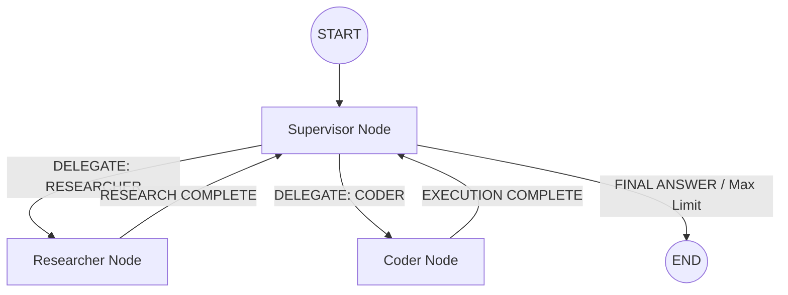

# Supervisory Multi-Agent System (MAS) in Rust

A production-grade, deterministic, and explainable **Supervisory Multi-Agent System (MAS)** implemented in idiomatic Rust. Built using the [`rig`](https://github.com/0xPlaygrounds/rig) LLM orchestration framework, local Ollama models, symbolic computer algebra (`mathcore`), and native data visualization (`plotters`).

This architecture ports cyclic LangGraph supervisory workflows into a type-safe Rust state machine with **Explainable AI (XAI)** audit logging and **Context Window Isolation** for binary artifacts.

---

## 🏗️ System Architecture

The system implements a cyclic **Supervisor-Worker** pattern managed by an explicit finite state machine (`SupervisoryScientificMas`).



### Core Agents
1. **Supervisor Agent**: Acts as the central orchestrator. Evaluates conversation history, breaks down user prompts into atomic subtasks, delegates work to specialized agents, and synthesizes the final response.
2. **Researcher Agent**: Equipped with external knowledge and Retrieval-Augmented Generation (RAG) tools (`wikipedia`, `arxiv`, `search_library_docs`). Gathers factual data, academic abstracts, and library syntax.
3. **Coder Agent**: Executes deterministic computations and generates visual artifacts using native Rust tools (`symbolic_calculate`, `render_bar_chart`).

---

## 📁 Project Structure & Code Walkthrough

```text
gfrig_supervisory_mas/
├── src/
│   ├── lib.rs               # Public crate exports and module declarations
│   ├── main.rs              # Application entry point & benchmark execution scenarios
│   ├── state.rs             # Shared MAS state, message history, and XAI trace structures
│   ├── graph.rs             # Core graph-flow execution loop and deterministic routing
│   ├── tools_researcher.rs  # Wikipedia, arXiv, and unified library documentation RAG tools
│   ├── tools_coder.rs       # MathCore CAS engine and Plotters PNG generator
│   └── visualizer.rs        # Static and runtime Mermaid diagram generator
├── tests/
│   └── supervisory_mas_integration_test.rs  # Unit and integration test suite
└── docs/
    └── supervisory_graph_trace.md           # Auto-generated XAI execution trace
```

### 1. State Management & Explainable AI (`src/state.rs`)
The `SupervisoryMasState` struct serves as the single source of truth passed across graph transitions:
* **`messages`**: Stores the chronological dialogue (`User`, `Supervisor`, `Researcher`, `Coder`) formatted for LLM prompt injection via `format_history_for_prompt()`.
* **`delegation_count`**: Prevents infinite delegation loops by enforcing a hard ceiling (`max_delegations`).
* **`trace: Vec<TraceStep>`**: Records every state transition (`step`, `node`, `action`, `details`) for post-hoc XAI auditing and JSON serialization.
* **`generated_chart_b64: Option<String>`**: Dedicated state field holding Base64-encoded PNG charts independently from the text conversation history.

### 2. Graph Orchestration & Routing (`src/graph.rs`)
The `SupervisoryScientificMas::run` method drives the asynchronous state machine:
* **Atomic Prompt Engineering**: Agents are instructed with strict output prefixes (`DELEGATE: RESEARCHER`, `DELEGATE: CODER`, `FINAL ANSWER:`, `RESEARCH COMPLETE`, `EXECUTION COMPLETE`).
* **Deterministic Parsing (`parse_supervisor_decision`)**: Parses LLM outputs into strongly-typed `SupervisorDecision` enums with fallback heuristics to ensure resilience against minor LLM formatting drift.
* **Context Isolation Pattern**: When `GraphNode::Coder` finishes executing, it retrieves binary chart payloads out-of-band and stores them directly in `state.generated_chart_b64`, keeping the LLM context lightweight.

### 3. Neuro-Symbolic & Visualization Tools (`src/tools_coder.rs`)
* **`SymbolicCalculateTool`**: Wraps `mathcore` to perform exact symbolic differentiation (`differentiate`), integration (`integrate`), root finding (`solve`), evaluation (`evaluate`), and separable ordinary differential equations (`ode_separable`).
* **`RenderBarChartTool`**: Uses `plotters` (`BitMapBackend`) to render high-resolution `960x560` PNG charts directly to disk.
* **Solving the Token Exhaustion (`finish_reason=Length`) Bottleneck**: Passing raw Base64 strings (often 45,000+ characters) back through an LLM tool response exhausts local model output budgets. To solve this cleanly:
  1. `RenderBarChartTool` encodes the saved PNG into Base64 and stores it in a thread-local buffer (`LAST_GENERATED_BASE64`).
  2. The tool returns only a concise text confirmation (`"EXECUTION COMPLETE: Chart successfully saved..."`) to the LLM.
  3. The graph orchestrator extracts the payload via `take_last_generated_base64()` and injects it into `SupervisoryMasState` for XAI compliance.

### 4. Factual & RAG Research Tools (`src/tools_researcher.rs`)
* **`WikipediaTool`**: Queries the MediaWiki API (`action=query&list=search`) and strips HTML highlight tags for clean factual retrieval.
* **`ArxivTool`**: Queries the arXiv XML API and parses recent scientific preprints using `roxmltree`.
* **`DocsRagTool`**: Provides targeted syntax guidance for scientific libraries (`MathCore`, `SymPy`, `SciPy`, `NumPy`, `Pandas`, `Polars`, `Rig`) using both curated rule-based knowledge and live HTML title scraping via `scraper`.

### 5. Execution Visualization (`src/visualizer.rs`)
Converts runtime `TraceStep` logs into Mermaid `flowchart LR` diagrams (`docs/supervisory_graph_trace.md`), allowing developers and auditors to visually inspect the exact sequence of agent delegations.

---

## 🚀 Getting Started

### Prerequisites
1. **Rust Toolchain**: Install Rust (1.75+ recommended) via [rustup.rs](https://rustup.rs/).
2. **Ollama**: Install [Ollama](https://ollama.com/) and ensure the local daemon is running.
3. **Pull the LLM Model**:
   ```bash
   ollama pull qwen3.5:9b
   ```

### Running the Application
Execute the built-in benchmark scenarios (Differential Equation Solving & Country Area Visualization):
```bash
cargo run
```

Upon completion, the system outputs:
* Analytical and factual answers in the terminal.
* `largest_countries_bar.png` in the project root directory.
* `docs/supervisory_graph_trace.md` containing the static topology and runtime Mermaid execution trace.

### Running the Test Suite
Verify decision parsing, state history formatting, MathCore symbolic operations, PNG rendering, and thread-local Base64 extraction:
```bash
cargo test
```

---

## 🛡️ Key Design Principles
* **Type Safety Over String Parsing**: State transitions and agent roles are governed by Rust enums (`AgentRole`, `GraphNode`, `SupervisorDecision`).
* **Separation of Data & Control Planes**: Textual reasoning stays in the LLM prompt context (Control Plane), while heavy binary artifacts move through thread-local/state channels (Data Plane).
* **Zero Python Runtime Dependency**: Replaces external Python interpreters (`sympy`, `matplotlib`) with compiled, memory-safe Rust crates (`mathcore`, `plotters`).