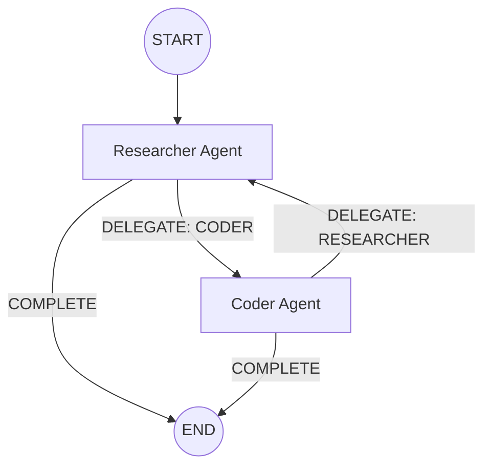

# 🐝 Rust Swarm Multi-Agent System (MAS)

A high-performance, type-safe, and decentralized **Multi-Agent Swarm** framework implemented in **Rust** using the [Rig](https://github.com/0xPlaygrounds/rig) framework and the **Tokio** asynchronous runtime. 

This project ports traditional Python-based agentic workflows (such as LangGraph Swarm architectures) into native, memory-safe Rust with zero interpreter overhead.

---

## 🏛️ Architecture & Core Components

Unlike hierarchical supervisor-worker topologies, this system implements a **decentralized Swarm network** where agents (`Researcher` and `Coder`) communicate via peer-to-peer handoffs using native tools.



### **1. Agents & Tools**

- **Researcher Agent:** Equipped with web and documentation search tools (`Wikipedia`, `Arxiv`, and targeted library RAG via `search_library_docs`). It gathers factual data and syntax rules.
- **Coder Agent:** Equipped with neuro-symbolic calculators (`symbolic_calculate` powered by `mathcore`) and visualization tools (`render_bar_chart` utilizing `plotters`).
- **Swarm Control Tools:**
  - **delegator:** Allows agents to dynamically hand off execution subtasks to peer agents.
  - **complete_task:** Finalizes the workflow and outputs the resolved answer.

### **2. Project Structure**

- `src/lib.rs` — Library root registering all internal modules.
- `src/main.rs` — Entry point running asynchronous tasks and saving Mermaid execution diagrams.
- `src/graph_swarm.rs` — Decentralized peer-to-peer routing and tool definitions (`DelegatorTool`, `CompleteTool`).
- `src/state.rs` — Shared state management (`SwarmMasState`, message history tracking).
- `src/tools_researcher.rs` — External API and documentation scraping tools.
- `src/tools_coder.rs` — Symbolic computation and native chart rendering engines.
- `src/visualizer.rs` — Static and dynamic Mermaid topology exporter.

## 🚀 Getting Started

### **Prerequisites**

- Rust (Edition 2024+) installed.
- [Ollama](https://ollama.com/) running locally with your preferred model (e.g., `qwen3.5:9b`).
  
### **Running the Project**

Clone the repository and run the main binary using Cargo:

```bash
cargo run
```

### **Running Tests**

Execute the integration and unit test suite to verify routing logic and tool executions:

```bash
cargo test
```

## 💡 Key Benefits of the Rust Port

1. **Zero-Cost Abstractions & Memory Safety:** No Global Interpreter Lock (GIL) or heavy Python runtime overhead.
2. **Native Concurrency:** Ultra-fast execution powered by `tokio`.
3. **Robust Ecosystem:** Direct PNG chart generation via `plotters` and symbolic math processing without risky dynamic eval injections.